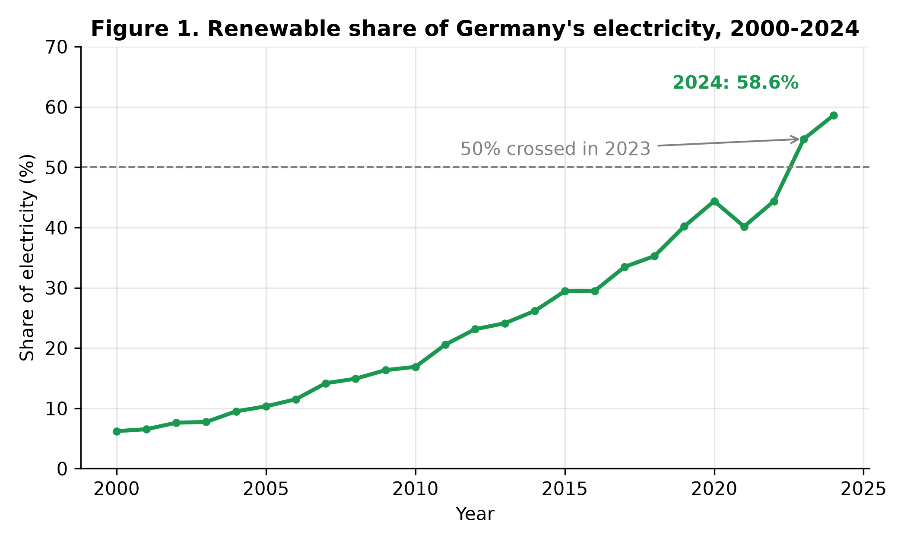
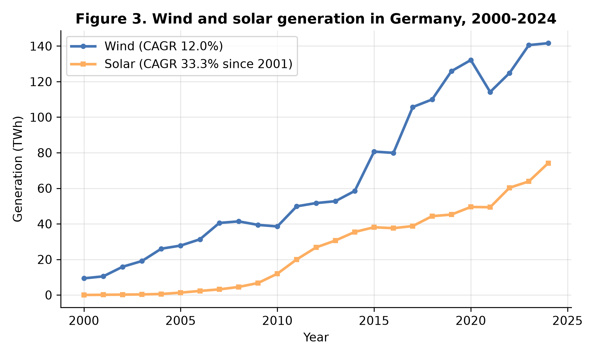
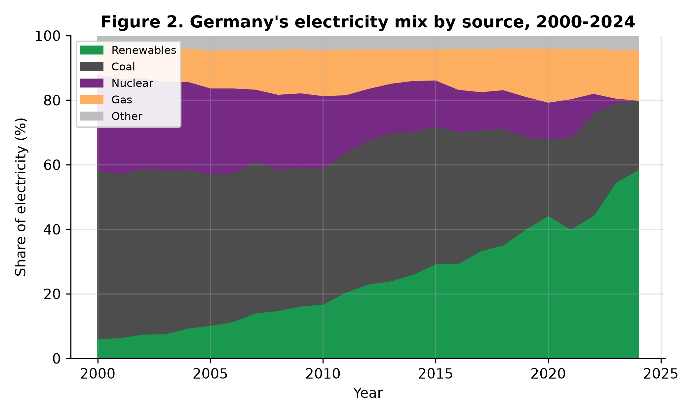
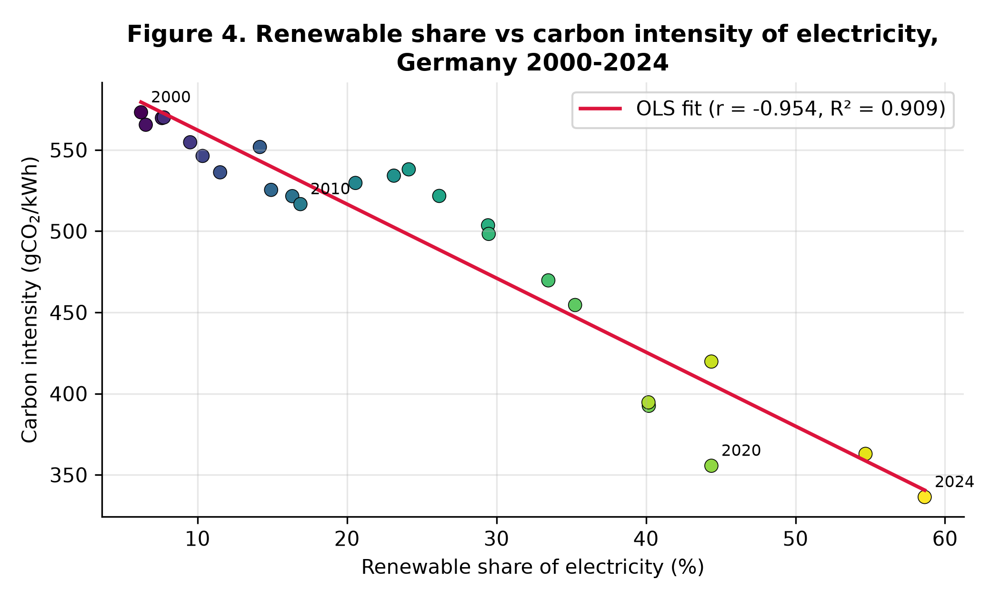
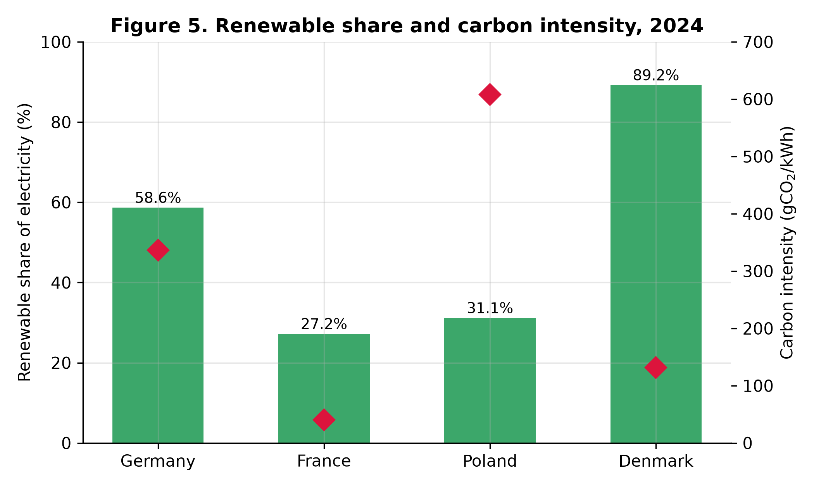
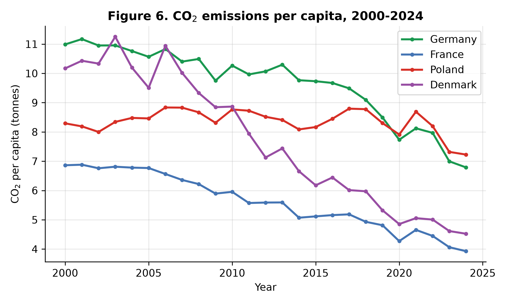

# From 6% to 59%: A Data Analysis of Germany's Renewable Electricity Transition, 2000–2024, with a Comparison to France, Poland and Denmark

**Rashed Rana**
Master's student, Artificial Intelligence for Industrial Applications,
OTH Amberg-Weiden, Germany
*Draft — not yet submitted. All results are computed from the published
datasets cited below; analysis code is openly available (see Data
Availability).*

---

## Abstract

Germany's electricity system has been rebuilt within a single generation.
Using the Our World in Data energy dataset (compiled from Ember's
Electricity Data Explorer and the Energy Institute Statistical Review) and
the OWID CO₂ dataset, this study analyses annual data for 2000–2024 with
descriptive statistics, growth rates and ordinary least-squares regression,
complemented by a structured SQL analysis, and compares Germany with
France, Poland and Denmark. The renewable share of German electricity rose
from 6.2% in 2000 to 58.6% in 2024 (+2.05 percentage points per year,
R² = 0.95), crossing 50% in 2023. Wind and solar supplied 80.8% of this
growth. Coal's share fell from 52.2% to 21.4% and nuclear generation ended
completely (29.8% → 0%). The carbon intensity of electricity fell 41.3% and
is strongly associated with the renewable share (r = −0.95; ≈ −4.6 gCO₂/kWh
per percentage point). Two shocks — COVID-19 (demand −3.5% in 2020) and the
2022 energy crisis (a temporary coal rebound from 28.5% to 31.7%) — are
clearly visible but did not reverse the trend. The comparison shows that
decarbonisation strategy matters: Denmark leads on renewables (89.2%) and
per-capita emission cuts (−55.5%), while France achieves the lowest carbon
intensity (41 gCO₂/kWh) through nuclear power. A linear extrapolation of
Germany's trend reaches the 80%-by-2030 target only in 2039, indicating
that the target requires acceleration beyond the historical rate.

**Keywords:** renewable energy transition; Germany; electricity mix;
carbon intensity; data analysis; Energiewende

---

## 1. Introduction

Few industrial countries have attempted to rebuild their electricity
system as deliberately as Germany. The Renewable Energy Sources Act (EEG)
of 2000 introduced guaranteed feed-in tariffs; the years after the 2011
Fukushima accident added a binding nuclear phase-out, completed in April
2023; and the amended EEG of 2023 set a target of 80% renewable
electricity by 2030. This policy sequence makes Germany a natural case
study for a simple empirical question: *how large, how fast, and driven by
which sources was the change — and what did it do to emissions?*

This study answers that question with a reproducible data analysis of the
full period 2000–2024 and places Germany next to three instructive
contrasts: Denmark, an early wind pioneer; France, which decarbonised
mainly through nuclear power; and Poland, which remained coal-centred.
Three contributions follow. First, the paper quantifies the German
transition with a small set of transparent statistics rather than a
narrative. Second, it separates the contribution of wind and solar from
other renewables. Third, it tests how closely the fall in the carbon
intensity of electricity tracks the renewable share — and documents where
the association breaks, notably in the crisis year 2022.

## 2. Data and Methods

**Data.** All series come from two openly published datasets. The Our
World in Data (OWID) energy dataset compiles electricity generation by
source, source shares, electricity demand and the carbon intensity of
electricity from Ember's Electricity Data Explorer and the Energy
Institute Statistical Review of World Energy. CO₂ per capita comes from
the OWID CO₂ dataset (Global Carbon Project). The analysis uses annual
observations for Germany, France, Poland and Denmark, 2000–2024
(n = 25 per country). The extracted analysis table (100 rows × 23
variables) is published with the project.

**Methods.** The study combines three standard tools. (i) *Descriptive
statistics and growth accounting:* changes in percentage points, multiples,
and compound annual growth rates (CAGR) for generation by source.
(ii) *Regression:* ordinary least squares (OLS) of the carbon intensity of
electricity on the renewable share for Germany (n = 25), reported with the
Pearson correlation and R²; and a linear time trend of the renewable share
used for a deliberately naive projection of the 80% target year.
(iii) *SQL analysis:* the analysis table was loaded into a SQLite
database and queried with nine documented queries covering shares,
milestones (first year above 50% renewables; first year renewables
exceeded coal), per-decade growth, the 2018–2024 shock window, and the
cross-country per-capita comparison. All numbers in this paper were
generated by the published code (`src/analysis.py`, `sql/queries.sql`);
no figure is typed by hand. The regression estimates an association, not
a causal effect; Section 5 discusses this limitation.

## 3. Results

### 3.1 The scale and pace of the transition

The renewable share of Germany's electricity rose from **6.22% in 2000 to
58.64% in 2024** — a 9.4-fold increase (Figure 1). The fitted linear trend
is +2.05 percentage points per year (R² = 0.95), and the 50% threshold was
crossed in **2023** (54.69%), nine years after Denmark (2014) but well
ahead of France and Poland, which remain below 32%. Renewable generation
overtook coal generation in **2019**. Extrapolating the 2000–2024 trend
linearly, the share reaches 80% only in **2039** — nine years after the
2030 target date. The target therefore implies an acceleration relative
to the historical trend, not its continuation.

*Figure 1. Renewable share of Germany's electricity, 2000–2024.*

### 3.2 Wind and solar supplied four-fifths of the growth

Total renewable generation grew from 35.4 TWh (2000) to 290.9 TWh (2024).
**Wind and solar together account for 80.8% of that increase** (Figure 3).
Wind generation rose from 9.35 TWh to 141.6 TWh (CAGR 12.0%), reaching a
28.6% share of all electricity in 2024. Solar grew fastest: from 0.10 TWh
in 2001 (the first non-zero year) to 74.13 TWh in 2024 (CAGR 33.3%), a
14.9% share. Hydropower, the dominant renewable of 2000, grew slowly, so
the transition is overwhelmingly a wind-and-solar story.

*Figure 3. Wind and solar generation in Germany, 2000–2024.*

### 3.3 Coal decline and the completed nuclear exit

The mirror image of the renewable rise is the fall of the incumbents
(Figure 2). Coal's share dropped from **52.15% (2000) to 21.44% (2024)**,
and coal generation fell in absolute terms from 296.7 TWh to 106.3 TWh.
Nuclear power declined from 29.81% of generation in 2000 to 6.12% in 2022
and **0% in 2024**, following the completion of the phase-out in April
2023. Gas partly filled the gap, rising from 8.65% to 15.81%.

*Figure 2. Germany's electricity mix by source, 2000–2024.*

### 3.4 Emissions: a strong association, with one visible exception

The carbon intensity of German electricity fell from **573.2 gCO₂/kWh in
2000 to 336.4 gCO₂/kWh in 2024 (−41.3%)**. Across the 25 annual
observations it is strongly negatively associated with the renewable
share (Figure 4): Pearson r = −0.95, R² = 0.91, with an OLS slope of
**−4.56 gCO₂/kWh per additional percentage point of renewable share**.
CO₂ emissions per capita fell from 10.99 t to 6.79 t (−38.2%) over the
same period (Figure 6).

*Figure 4. Renewable share vs carbon intensity of electricity, Germany
2000–2024. Colour scale: year.*

### 3.5 Two shocks: COVID-19 and the 2022 energy crisis

The annual data register both shocks cleanly. Electricity demand fell
**3.5% in 2020** (567.4 → 547.7 TWh) during COVID-19, then partly
recovered in 2021 (+2.3%). In **2022**, after the cut in Russian pipeline
gas, the gas share of generation fell from 15.60% to 13.95% while the
coal share **rebounded from 28.45% to 31.74%** and demand fell 3.7% —
a one-year, crisis-driven step backwards inside the long trend. By 2024
the coal share had fallen to a period low of 21.44% and the renewable
share reached its period high, indicating the rebound was temporary.

### 3.6 Comparison: three different decarbonisation strategies

The 2024 comparison (Figure 5, Table 1) shows that a low-carbon system
can be reached by different routes, at different speeds.

| Country | Renewables 2000 (%) | Renewables 2024 (%) | Coal 2024 (%) | Nuclear 2024 (%) | Carbon intensity 2024 (gCO₂/kWh) | CO₂ per capita 2000 → 2024 (t) | Change (%) |
|---|---|---|---|---|---|---|---|
| Germany | 6.22 | 58.64 | 21.44 | 0.00 | 336.4 | 10.99 → 6.79 | −38.2 |
| France | 12.74 | 27.18 | 0.18 | 67.72 | 40.5 | 6.86 → 3.93 | −42.8 |
| Poland | 1.63 | 31.15 | 54.32 | 0.00 | 608.2 | 8.29 → 7.23 | −12.9 |
| Denmark | 15.54 | 89.19 | 4.99 | 0.00 | 131.8 | 10.17 → 4.52 | −55.5 |

*Table 1. Electricity transition indicators, 2000–2024. Sources: OWID
energy and CO₂ datasets; values computed by the project code.*

Denmark, starting earliest, reached 89.19% renewables and the largest
per-capita emission cut (−55.5%). France has by far the cleanest
electricity (40.5 gCO₂/kWh) despite a modest renewable share, because
67.72% of its generation is nuclear. Poland illustrates the cost of
delay: still 54.32% coal, the highest carbon intensity (608.2 gCO₂/kWh)
and the smallest per-capita reduction (−12.9%). Germany sits between:
the fastest large-system renewable build-out of the four, but a carbon
intensity still 8 times France's because one-fifth of its electricity
still comes from coal.

*Figure 5. Renewable share and carbon intensity, 2024.*

*Figure 6. CO₂ emissions per capita, 2000–2024.*

## 4. Discussion

Three points deserve emphasis. First, the German transition is real and
large, but its *pace* is the policy problem: a trend that was sufficient
to reach 59% in 24 years is arithmetically insufficient for 80% by 2030.
Second, the composition matters. Because wind and solar supplied 80.8%
of renewable growth, future progress depends on the two most
weather-variable sources, which raises grid, storage and flexibility
questions that generation shares alone cannot answer. Third, the
comparison warns against equating "renewable" with "low-carbon" too
quickly: France's nuclear-based system is far cleaner per kWh today,
while Denmark shows that a renewables-led route can go furthest on
per-capita emissions. The 2022 coal rebound adds a resilience lesson:
progress built over two decades survived a severe supply shock with only
a one-year interruption — evidence that the transition is structural,
not cyclical.

## 5. Limitations

This is a descriptive analysis of annual aggregates, and four limits
apply. (1) The regression of carbon intensity on the renewable share is
an *association*: demand changes, fuel prices, carbon pricing and plant
closures move both variables, so the slope must not be read as the
causal effect of one percentage point of renewables. (2) Annual data
hide within-year variability — hourly matching of wind/solar output to
demand is where integration costs appear. (3) Shares are computed on
gross generation; cross-country differences in electricity trade (e.g.
Denmark's interconnection) are not modelled. (4) The 2039 projection is
a deliberately naive linear extrapolation used to gauge the distance to
the 2030 target, not a forecast. Extending the study with hourly data, a
multivariate model, and cost data are natural next steps.

## 6. Conclusions

Between 2000 and 2024 Germany moved from 6.2% to 58.6% renewable
electricity, ended nuclear generation, cut coal's share by more than
half, and reduced the carbon intensity of its electricity by 41.3% and
CO₂ per capita by 38.2%. Wind and solar drove the change; two major
shocks disturbed but did not reverse it. The remaining gap — phasing out
the last fifth of coal generation and accelerating from a +2.05
points-per-year trend to reach 80% by 2030 — is the central empirical
fact any continuation of this work, or of the policy itself, must start
from.

## Data Availability

Analysis code, the extracted dataset, SQL queries and all figures:
`github.com/rashedrana/germany-renewable-energy-analysis` (repository of
this project). Source datasets: OWID energy data
(github.com/owid/energy-data) and OWID CO₂ data
(github.com/owid/co2-data), both CC BY.

## References

- Ember (2024). *Electricity Data Explorer / Global Electricity Review.*
  ember-energy.org.
- Energy Institute (2024). *Statistical Review of World Energy.*
  energyinst.org.
- Global Carbon Project (2024). *Global Carbon Budget.* 
- Ritchie, H., Roser, M. & Rosado, P. (2022). "Energy." *Our World in
  Data.* ourworldindata.org/energy.
- German Federal Government (2023). *Renewable Energy Sources Act (EEG
  2023)* — 80% renewable electricity target for 2030.

## Declaration

This draft was prepared with AI assistance for data analysis and
drafting, under the author's direction; all results were verified
against the published datasets and the analysis code above, and the
author takes full responsibility for the content. The disclosure will be
adapted to the policy of the venue at submission.
