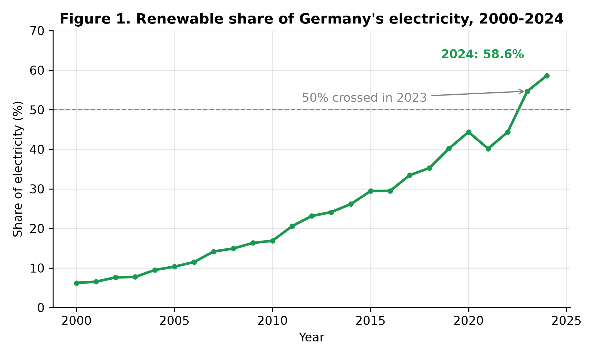
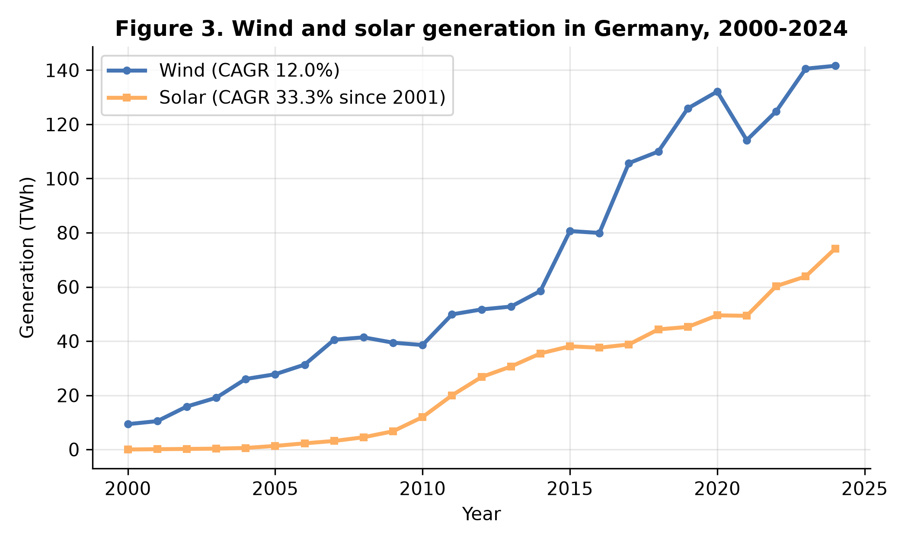
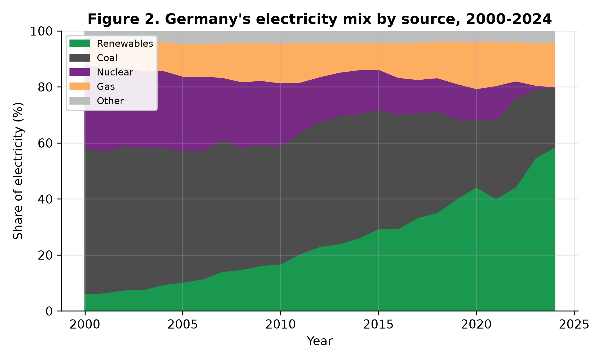
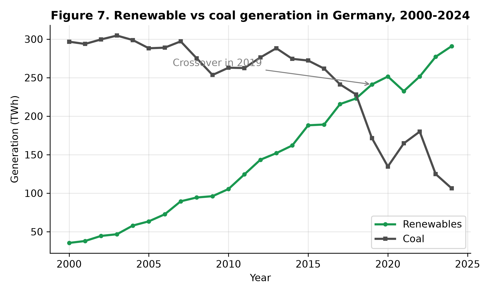
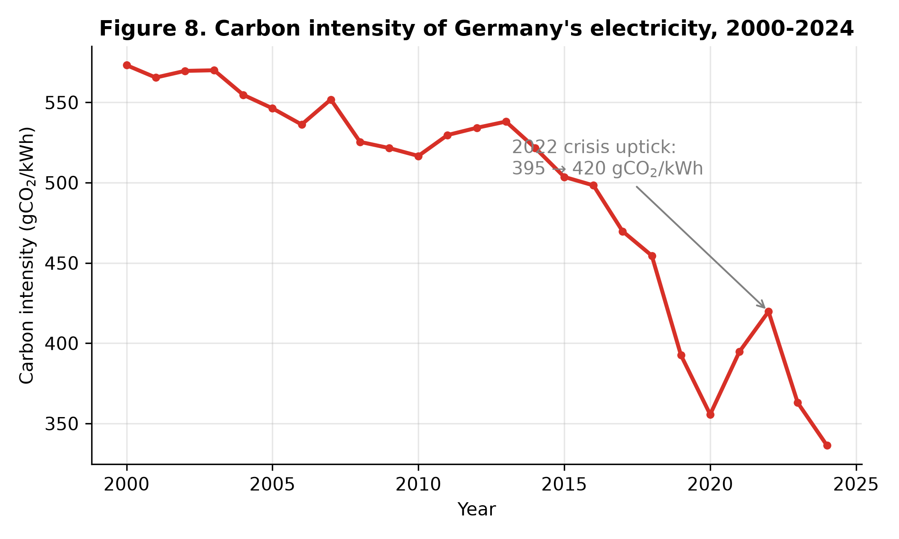
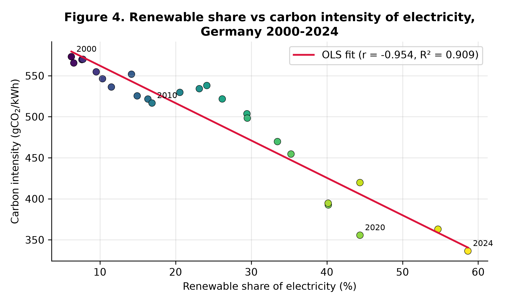
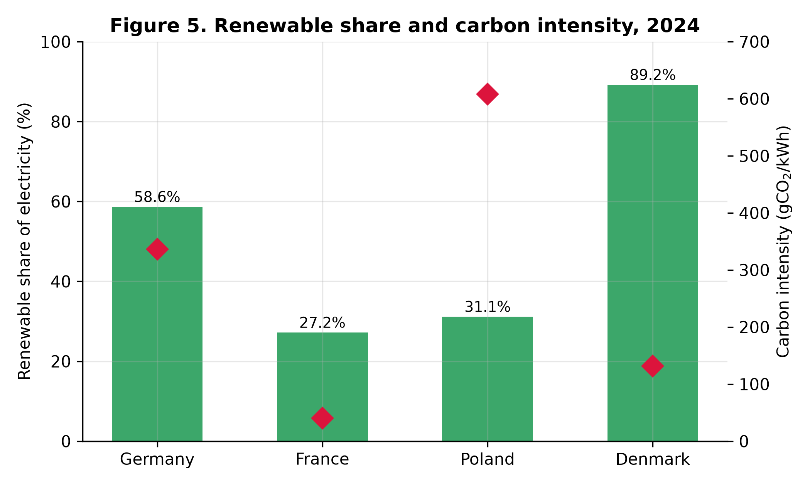
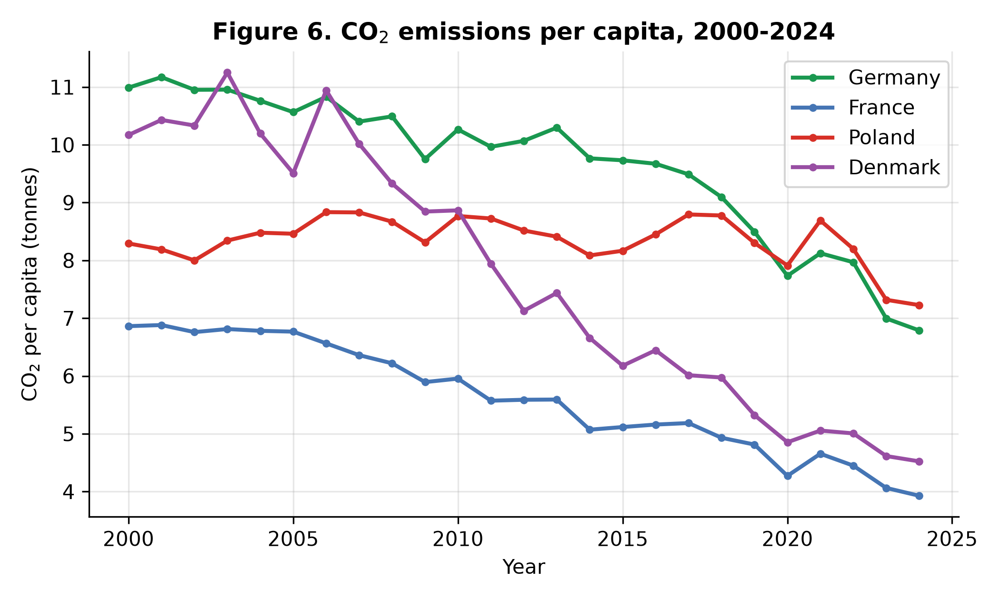

# From 6% to 59%: A Data Analysis of Germany's Renewable Electricity Transition, 2000–2024, with a Comparison to France, Poland and Denmark

**Rashed Rana**
Master's student, Artificial Intelligence for Industrial Applications,
OTH Amberg-Weiden, Germany

*Manuscript prepared for journal submission. All results are computed from
the published datasets cited below; the complete analysis code (Python and
SQL) is openly available (see Data Availability).*

---

## Abstract

Germany's electricity system has been rebuilt within a single generation.
Using the Our World in Data energy dataset (compiled from Ember's
Electricity Data Explorer and the Energy Institute Statistical Review) and
the OWID CO₂ dataset, this study analyses annual data for 2000–2024 using
descriptive statistics, growth accounting, ordinary least-squares
regression and a structured SQL analysis, and benchmarks Germany against
France, Poland and Denmark. The renewable share of German electricity rose
from 6.2% in 2000 to 58.6% in 2024, crossing 50% in 2023, and its growth
accelerated across three policy eras: +1.18 percentage points per year in
2000–2010, +2.28 in 2011–2019 and +4.31 in 2020–2024. Wind and solar
supplied 80.8% of all renewable growth. Coal's share fell from 52.2% to
21.4% and nuclear generation ended completely (29.8% → 0%). The carbon
intensity of electricity fell 41.3% (573 → 336 gCO₂/kWh) and is strongly
associated with the renewable share (r = −0.95; OLS slope −4.56 gCO₂/kWh
per percentage point, p < 0.001); a multivariate model shows the proximate
driver is the coal share (r = 0.996), which renewables displaced. Two
shocks — COVID-19 (demand −3.5% in 2020) and the 2022 energy crisis
(carbon intensity +6.4% in one year on a temporary coal rebound) — are
clearly visible but did not reverse the trend. Reaching the 80%-by-2030
target requires +3.56 points per year from 2024: above the 24-year average
pace (+2.05) but below the 2020–2024 pace (+4.31), so the target is
arithmetically reachable only if the recent acceleration is sustained.
The comparison shows that decarbonisation strategy matters: Denmark leads
on renewables (89.2%) and per-capita cuts (−55.5%), while France achieves
the lowest carbon intensity (41 gCO₂/kWh) through nuclear power.

**Keywords:** renewable energy transition; Germany; Energiewende;
electricity mix; carbon intensity; regression analysis; energy policy

---

## 1. Introduction

Few industrial countries have attempted to rebuild their electricity
system as deliberately, and as publicly, as Germany. The Renewable Energy
Sources Act (Erneuerbare-Energien-Gesetz, EEG) of 2000 introduced
guaranteed feed-in tariffs and priority grid access for renewable
generators. After the Fukushima accident in March 2011, the federal
government reversed its earlier lifetime extension for nuclear plants and
legislated a complete phase-out, which was completed in April 2023. The
Coal Phase-Out Act of 2020 set an end date for coal generation (2038 at
the latest, with a stated ambition of 2030), and the amended EEG of 2023
raised the expansion target to 80% renewable electricity by 2030, on the
path to a greenhouse-gas-neutral electricity system by 2035.

This sequence of decisions makes Germany a natural case study for a set
of empirical questions that public debate often answers with narratives
rather than numbers:

- **RQ1 (Scale and pace).** How large and how fast was the change in
  Germany's electricity mix between 2000 and 2024, and has the pace been
  constant across the policy eras?
- **RQ2 (Drivers).** Which sources account for the renewable growth, and
  which sources did they displace?
- **RQ3 (Emissions).** How closely does the fall in the carbon intensity
  of electricity track the renewable share, and through which variable
  does the association operate?
- **RQ4 (Resilience).** How did the two largest recent shocks — the
  COVID-19 pandemic and the 2022 European energy crisis — register in the
  data, and were their effects temporary?
- **RQ5 (Strategy).** How does Germany's renewables-led path compare with
  Denmark's earlier wind-led path, France's nuclear-led path, and Poland's
  coal-centred path?

The study answers these questions with a fully reproducible data analysis:
every number reported below is generated by published code (Python and
SQL) from two openly available datasets. The contribution is threefold.
First, the paper quantifies the completed 2000–2024 period — including
the first two years after the nuclear exit — with a small set of
transparent statistics rather than a narrative. Second, it separates
*association* from *mechanism* in the emissions result: the renewable
share correlates almost perfectly with falling carbon intensity, but the
multivariate analysis shows the proximate driver is the coal share, which
renewables displaced; treating the bivariate slope as a causal effect
would be a misreading the paper explicitly avoids. Third, it evaluates
the 80%-by-2030 target arithmetically against three different trend
windows, showing that the verdict — reachable or not — depends on which
era's pace is extrapolated, a nuance missing from most public debate.

Section 2 reviews the relevant literature. Section 3 describes the data
and methods. Section 4 presents the results by research question.
Section 5 discusses implications, Section 6 states limitations, and
Section 7 concludes.

## 2. Literature Review

**Policy design and diffusion.** The German support scheme has been
studied since its early years. Jacobsson and Lauber [8] explain the
unusually rapid diffusion of wind turbines and solar cells in Germany by
the design of the feed-in system and by the political process behind it:
a parliamentary advocacy coalition sustained generous, technology-specific
support against incumbent opposition, creating protected markets in which
the technologies could mature. This "market creation" account predicts
exactly the pattern visible in the aggregate data analysed here — slow
initial growth under the 1991 Feed-in Law, then sustained acceleration
once the EEG (2000) stabilised investor expectations.

**Costs and the critical debate.** The scheme's costs were contested from
the start. Frondel et al. [3], reviewing the EEG's first decade,
argue that the feed-in tariffs failed to harness market incentives,
imposed massive expenditures, and delivered limited net employment or
climate benefits relative to their cost. Their critique is a useful
reminder that *deployment success* (the subject of this paper) and
*cost-effectiveness* (not measured here) are different evaluation
criteria; a complete assessment of the Energiewende needs both. The IEA's
most recent in-depth review similarly concludes that the Energiewende
"has been effective at increasing the share of renewable energy supply"
in electricity, while criticising the uneven progress in transport and
heating and urging faster grid expansion and hydrogen development
[7].

**Variability, market value and system costs.** A second strand of the
literature asks what happens as variable renewables (VRE) grow beyond
niche shares. Hirth [6] shows that the market value of wind and solar
falls with their penetration — wind's value factor declines towards
50–80% of the average electricity price at 30% penetration, and solar's
falls faster — because VRE output concentrates in hours when it
depresses prices. Ueckerdt et al. [11] formalise the same point as
"system LCOE": the integration costs of variability rise with
penetration and are not captured by plant-level cost comparisons. Sinn
(2017), working with hourly German data, argues that buffering VRE
volatility without conventional back-up would require implausibly large
storage, and that beyond roughly a third of production, oversupply makes
further expansion progressively harder. These studies frame the central
open question for the period after 2024: Germany has now passed the
penetration levels at which integration costs were predicted to bite
(wind and solar alone supplied 43.5% of generation in 2024), so the
*next* phase of the transition is analytically different from the phase
documented here.

**This study's position.** Most empirical accounts of the German
transition are either policy narratives, cost-benefit evaluations, or
model-based system studies. A transparent, replication-first statistical
account of the full 2000–2024 outcome data — deployment, displacement,
emissions, shocks, and a cross-country benchmark in one place — remains
scarce, and is what this paper provides.

## 3. Data and Methods

### 3.1 Data

All series come from two openly published datasets maintained by Our
World in Data (OWID). The OWID energy dataset compiles electricity
generation by source, source shares of generation, electricity demand and
the carbon intensity of electricity from Ember's Electricity Data
Explorer and the Energy Institute Statistical Review of World Energy
[1], [2]. CO₂ emissions per capita come from
the OWID CO₂ dataset, sourced from the Global Carbon Project [5]. The
analysis uses annual observations for four countries — Germany, France,
Poland and Denmark — over 2000–2024 (n = 25 per country; 100 rows in the
extracted analysis table). The four were chosen as archetypes: Germany
(large industrial system, renewables-led policy), Denmark (earliest and
deepest wind penetration), France (nuclear-led decarbonisation) and
Poland (coal-centred system starting latest).

*Table 1. Variables used.*

| Variable | Unit | Role |
|---|---|---|
| renewables_share_elec | % of generation | main outcome (RQ1, RQ3) |
| wind_electricity, solar_electricity | TWh | growth drivers (RQ2) |
| coal_share_elec, nuclear_share_elec, gas_share_elec | % of generation | displacement (RQ2, RQ3) |
| carbon_intensity_elec | gCO₂/kWh | emissions outcome (RQ3) |
| co2_per_capita | tonnes | emissions outcome (RQ3, RQ5) |
| electricity_demand | TWh | control / shock measure (RQ3, RQ4) |

### 3.2 Methods

Four complementary methods are used. **(i) Descriptive statistics and
growth accounting:** changes in percentage points and in absolute
generation (TWh), and compound annual growth rates (CAGR) for wind and
solar generation. **(ii) Trend analysis:** ordinary least squares (OLS)
of the renewable share on calendar year, fitted for the full period and
separately for three policy eras (2000–2010, the EEG build-up; 2011–2019,
the post-Fukushima decade; 2020–2024, the crisis-and-acceleration era),
and used to evaluate the 80%-by-2030 target under alternative
extrapolations. The projections are deliberately naive benchmarks, not
forecasts (Section 6). **(iii) Regression analysis of emissions:** a
bivariate OLS of carbon intensity on the renewable share, and a
multivariate OLS adding the coal share, the gas share and electricity
demand, reported with standard errors, t-statistics and p-values
(n = 25). Because generation shares are compositional (they sum to
approximately 100%), the multivariate coefficients are interpreted
relative to the omitted sources, and multicollinearity is discussed
rather than hidden. **(iv) SQL analysis:** the analysis table was loaded
into a SQLite database and interrogated with nine documented queries
(share series, milestone years, decade growth, shock windows, rankings),
whose outputs are published with the project and cross-check the Python
results. All computations were performed in Python (pandas, statsmodels)
and SQLite; the code and the extracted dataset are openly available (Data
Availability), and every figure and table in this paper is generated
from them.

## 4. Results

### 4.1 Scale and pace: a nine-fold expansion that accelerated (RQ1)

The renewable share of Germany's electricity rose from **6.22% in 2000 to
58.64% in 2024** — a 9.4-fold increase (Figure 1). Renewable generation
overtook coal generation in **2019** (Figure 7), and the 50% threshold was
crossed in **2023** (54.69%), nine years after Denmark (2014) but well
ahead of France and Poland, which remained below 32% in 2024. The fitted
linear trend over the full period is +2.05 percentage points per year
(R² = 0.95).

*Figure 1. Renewable share of Germany's electricity, 2000–2024.*

The pace was not constant. Splitting the period into the three policy
eras reveals a clear acceleration:

- **2000–2010 (EEG build-up):** 6.22% → 16.89%, trend **+1.18 points/year**;
- **2011–2019 (post-Fukushima):** 20.57% → 40.19%, trend **+2.28 points/year**;
- **2020–2024 (crisis and acceleration):** 44.37% → 58.64%, trend **+4.31 points/year**.

This acceleration changes the arithmetic of the 80%-by-2030 target. From
58.64% in 2024, the target requires **+3.56 points per year** for six
years. That is far above the 24-year average pace (+2.05, which would
reach 80% only in 2039) and above the 2011–2019 pace (+2.28) — but *below*
the pace actually achieved in 2020–2024 (+4.31). The target is therefore
neither safely on track nor out of reach: it is attainable if, and only
if, the most recent era's pace — which itself benefited from falling
demand (Section 4.5) — is sustained for six more years.

### 4.2 Drivers: wind and solar supplied four-fifths of the growth (RQ2)

Total renewable generation grew from 35.4 TWh (2000) to 290.9 TWh (2024).
**Wind and solar together account for 80.8% of that increase** (Figure 3).
Wind generation rose from 9.35 TWh to 141.6 TWh (CAGR 12.0%) and reached
28.55% of all electricity in 2024. Solar grew fastest of all: from
0.10 TWh in 2001 (the first non-zero year in the dataset) to 74.13 TWh in
2024 (CAGR 33.3%), a 14.95% share. Together, wind and solar alone supplied
43.5% of Germany's electricity in 2024 — a larger share than nuclear
power supplied in 2000 (29.8%), at what was then its historical peak role
in the system.
Hydropower, the leading renewable in 2000, grew only slowly, as did
biomass after its initial expansion; the transition is overwhelmingly a
wind-and-solar story, exactly as the early diffusion literature expected
from the EEG's technology-specific tariffs [8].

*Figure 3. Wind and solar generation in Germany, 2000–2024.*

### 4.3 Displacement: coal halved, nuclear ended (RQ2)

The mirror image of the renewable rise is the decline of the incumbents
(Figures 2 and 7). Coal's share fell from **52.15% (2000) to 21.44%
(2024)**, and coal generation fell in absolute terms from 296.7 TWh to
106.3 TWh. Nuclear power declined from 29.81% of generation in 2000 to
6.12% in 2022 and **0% in 2024**, following the completion of the
phase-out in April 2023 — the first full calendar year without nuclear
generation in the dataset is 2024. Gas partly filled the gap left by both,
rising from 8.65% to 15.81%.

*Figure 2. Germany's electricity mix by source, 2000–2024.*

*Figure 7. Renewable vs coal generation in Germany, 2000–2024.*

### 4.4 Emissions: association, mechanism, and a warning against causal reading (RQ3)

The carbon intensity of German electricity fell from **573.2 gCO₂/kWh in
2000 to 336.4 gCO₂/kWh in 2024 (−41.3%)** (Figure 8). The bivariate
association with the renewable share is very strong: Pearson
r = −0.95, and the OLS regression gives a slope of **−4.56 gCO₂/kWh per
additional percentage point of renewable share** (SE 0.30, t = −15.18,
p < 0.001, R² = 0.909, n = 25). CO₂ emissions per capita fell from
10.99 t to 6.79 t (−38.2%) over the same period (Figure 6).

*Figure 8. Carbon intensity of Germany's electricity, 2000–2024.*

*Figure 4. Renewable share vs carbon intensity of electricity, Germany
2000–2024.*

The multivariate model (Table 2) shows *through which variable* this
association operates — and why the bivariate slope must not be quoted as
"the effect of renewables". With the coal share, gas share and demand
included, the model fits almost perfectly (R² = 0.999), because carbon
intensity is close to an accounting identity of the generation mix. The
dominant coefficient is the **coal share: +10.57 gCO₂/kWh per percentage
point** (p < 0.001), followed by gas (+6.05, p < 0.001); consistently, the
raw correlation between the coal share and carbon intensity is 0.996.
The renewable-share coefficient changes sign (+0.91) once the fossil
shares are held constant — a mechanical consequence of compositional
data (shares sum to ~100%, so one share can only rise at another's
expense) rather than evidence that renewables raise emissions. The
correct reading of the two models together is a displacement mechanism:
renewables and the coal share are correlated at r = −0.95, renewables
grew by replacing coal first and nuclear second, and it is the coal
replacement that delivers the carbon-intensity decline. Studies that
report only the bivariate relationship overstate what the data can say;
the mechanism matters for policy, because replacing the *remaining*
21.4% of coal generation offers roughly twice the carbon-intensity gain
per point of replacing gas.

*Table 2. OLS regression of the carbon intensity of electricity
(gCO₂/kWh), Germany, 2000–2024 (n = 25). Standard errors in parentheses.*

| Variable | Coefficient | Std. error | t | p |
|---|---|---|---|---|
| Constant | −81.84 | 22.49 | −3.64 | 0.002 |
| Renewable share (%) | 0.91 | 0.13 | 6.82 | <0.001 |
| Coal share (%) | 10.57 | 0.34 | 30.92 | <0.001 |
| Gas share (%) | 6.05 | 0.59 | 10.26 | <0.001 |
| Electricity demand (TWh) | 0.08 | 0.03 | 2.41 | 0.026 |

*R² = 0.999, adjusted R² = 0.999, F = 6119.96 (p < 0.001). The near-perfect
fit reflects the near-identity between carbon intensity and the fossil
shares; coefficients on compositional shares are interpreted relative to
the omitted sources (nuclear, hydro and other), as discussed in the text.*

### 4.5 Two shocks: COVID-19 and the 2022 energy crisis (RQ4)

The annual data register both shocks cleanly. Electricity demand fell
**3.5% in 2020** (567.4 → 547.7 TWh) during COVID-19, partly recovered in
2021 (+2.3%), and the renewable share jumped in 2020 (40.19% → 44.37%)
partly *because* the denominator shrank. In **2022**, after the cut in
Russian pipeline gas, the gas share of generation fell from 15.60% to
13.95%, the coal share **rebounded from 28.45% to 31.74%**, demand fell
3.7%, and the carbon intensity of electricity **rose 6.4% in a single
year** (394.6 → 419.7 gCO₂/kWh) — the only interruption of its decline in
the series. By 2024 the coal share had fallen to a period low (21.44%)
and carbon intensity to 336.4 gCO₂/kWh, confirming the rebound was a
one-year crisis response inside a structural trend. One further fact
conditions all share-based results: German electricity demand peaked in
**2007 at 614.5 TWh** and has trended downward since (−2.59 TWh/year), so
part of the renewable share's growth is a denominator effect — a point
taken up in Sections 5 and 6.

### 4.6 Comparison: three different decarbonisation strategies (RQ5)

The 2024 comparison (Table 3, Figures 5–6) shows that a low-carbon system
can be approached by different routes at different speeds. **Denmark**,
starting earliest, reached 89.19% renewables and achieved the largest
per-capita emission cut of the four (−55.5%). **France** has by far the
cleanest electricity (40.5 gCO₂/kWh) despite a modest renewable share
(27.18%), because 67.72% of its generation is nuclear. **Poland**
illustrates the cost of delay: still 54.32% coal, it has the highest
carbon intensity (608.2 gCO₂/kWh) and the smallest per-capita reduction
(−12.9%). **Germany** sits between the archetypes: the fastest renewable
build-out of any large system in the sample (+52.4 points since 2000),
yet a carbon intensity still eight times France's, because one-fifth of
its electricity still comes from coal.

*Table 3. Electricity transition indicators, 2000–2024. Sources: OWID
energy and CO₂ datasets; values computed by the project code.*

| Country | Renewables 2000 (%) | Renewables 2024 (%) | Coal 2024 (%) | Nuclear 2024 (%) | Carbon intensity 2024 (gCO₂/kWh) | CO₂ per capita 2000 → 2024 (t) | Change (%) |
|---|---|---|---|---|---|---|---|
| Germany | 6.22 | 58.64 | 21.44 | 0.00 | 336.4 | 10.99 → 6.79 | −38.2 |
| France | 12.74 | 27.18 | 0.18 | 67.72 | 40.5 | 6.86 → 3.93 | −42.8 |
| Poland | 1.63 | 31.15 | 54.32 | 0.00 | 608.2 | 8.29 → 7.23 | −12.9 |
| Denmark | 15.54 | 89.19 | 4.99 | 0.00 | 131.8 | 10.17 → 4.52 | −55.5 |

*Figure 5. Renewable share and carbon intensity, 2024.*

*Figure 6. CO₂ emissions per capita, 2000–2024.*

## 5. Discussion

**The pace question is now the whole question.** The historical part of
the German transition is, by the numbers, a success: a nine-fold increase
in renewable share, a completed nuclear exit, a halved coal share and a
41% cut in electricity carbon intensity, achieved without a single year
of system failure and with only a one-year reversal under the largest
energy-supply shock in post-war European history. What the trend analysis
adds is precision about the future: the 80%-by-2030 target requires a
pace (+3.56 points/year) that Germany has sustained only in the most
recent, demand-assisted era. Public debate that cites the 24-year average
("too slow, the target will be missed") and debate that cites the recent
acceleration ("well on track") are both extrapolating real numbers —
from different windows. The honest statement is conditional: the target
is reachable at the 2020–2024 pace, and that pace must now be maintained
for six consecutive years without the help of falling demand.

**Composition is the second question.** Because wind and solar supplied
80.8% of renewable growth, Germany has entered the penetration range in
which the variability literature [6], [10], [11] predicts rising integration costs and falling market values.
The annual data used here cannot test those predictions — they concern
*hours*, not years — but they define the research frontier for this
dataset's continuation: as wind and solar pass 43.5% of generation, the
binding constraints become grids, storage, flexibility and market
design, not deployment volume. The multivariate result points the same
way: with coal displacement identified as the emissions mechanism, the
remaining 21.4% of coal generation is the single largest lever left, and
replacing it with firm low-carbon capacity or flexibility yields more
than replacing gas.

**Strategy comparison cuts both ways.** France demonstrates that a
nuclear-led system can be far cleaner per kilowatt-hour than Germany's is
today, and did so decades earlier; Denmark demonstrates that a
renewables-led system can go furthest overall, helped by a small,
interconnected grid and exceptional wind resources. Neither comparison
reverses the evaluation of the German path — Germany is decarbonising a
large, industrial, formerly coal-and-nuclear system — but together they
show that "renewable share" and "clean electricity" are different
metrics, and that Germany currently leads on the first while trailing on
the second.

**On cost, this paper is deliberately silent.** The deployment record
documented here is compatible with both the supportive reading of the EEG
[7], [8] and the cost critique [3]. Deciding between them requires cost data — support
payments, system costs, avoided externalities — that this study does not
analyse; Section 6 lists this as a boundary, not a finding.

## 6. Limitations

Five limitations bound the conclusions. **(1) Association, not
causation.** All regressions are estimated on 25 annual observations of
trending series; coefficients describe co-movement, and the multivariate
model's near-perfect fit reflects the accounting structure of the data
rather than discovered causation. **(2) Compositional regressors.** The
generation shares sum to ~100%, inducing mechanical correlations (the
renewable share's sign change in Table 2 is the visible symptom); the
paper mitigates this by interpreting the bivariate and multivariate
models jointly, but a log-ratio specification would be the stricter
treatment. **(3) Annual aggregation.** Hourly phenomena — negative
prices, curtailment, storage needs — are invisible at this frequency;
the variability literature cited operates on hourly data for this
reason. **(4) The denominator effect.** Shares are ratios: the renewable
share rose partly because demand fell from its 2007 peak (614.5 TWh) to
522.3 TWh. Absolute renewable generation also grew 8.2-fold, so the
transition is not an artefact of demand decline, but share-based targets
inherit this sensitivity. **(5) Scope.** Costs, employment, land use,
public acceptance and trade in electricity (notably Denmark's
interconnection) are outside the dataset and the analysis.

## 7. Conclusions

Between 2000 and 2024 Germany moved from 6.2% to 58.6% renewable
electricity, ended nuclear generation, cut coal's share from 52.2% to
21.4%, reduced the carbon intensity of its electricity by 41.3% and CO₂
per capita by 38.2%. Wind and solar drove the change (80.8% of renewable
growth); the emissions decline operated through coal displacement; and
two major shocks — a pandemic and an energy crisis — disturbed the trend
for a single year each without reversing it. The remaining agenda is
precisely quantifiable: sustain at least +3.56 percentage points per
year to reach 80% renewables by 2030, and remove the last fifth of coal
generation, which the regression evidence identifies as the largest
remaining emissions lever. Whether the post-2024 system can do this at
penetration levels where integration costs rise is the question the next
study — ideally on hourly data — should take up.

## Data Availability

Analysis code, the extracted dataset, the nine SQL queries and all
figures are openly available in the project repository:
github.com/rashedrana/germany-renewable-energy-analysis. Source datasets:
OWID energy data (github.com/owid/energy-data) and OWID CO₂ data
(github.com/owid/co2-data), both published under CC BY licences.

## References

[1] Ember (2024). *Electricity Data Explorer; Global Electricity Review   2024.* ember-energy.org.

[2] Energy Institute (2024). *Statistical Review of World Energy 2024.*   energyinst.org.

[3] Frondel, M., Ritter, N., Schmidt, C. M. & Vance, C. (2010). "Economic   impacts from the promotion of renewable energy technologies: The   German experience." *Energy Policy* 38(8), 4048–4056.   doi:10.1016/j.enpol.2010.03.029.

[4] German Federal Government (2023). *Renewable Energy Sources Act   (Erneuerbare-Energien-Gesetz, EEG 2023)* — 80% renewable electricity   target for 2030.

[5] Global Carbon Project [5]. *Global Carbon Budget 2024.*

[6] Hirth, L. (2013). "The market value of variable renewables: The effect   of solar wind power variability on their relative price." *Energy   Economics* 38, 218–236. doi:10.1016/j.eneco.2013.02.004.

[7] IEA (2020). *Germany 2020: Energy Policy Review.* OECD/IEA, Paris.   doi:10.1787/cedb9b0a-en.

[8] Jacobsson, S. & Lauber, V. (2006). "The politics and policy of energy   system transformation — explaining the German diffusion of renewable   energy technology." *Energy Policy* 34(3), 256–276.

[9] Ritchie, H., Roser, M. & Rosado, P. (2022). "Energy." *Our World in   Data.* ourworldindata.org/energy.

[10] Sinn, H.-W. (2017). "Buffering volatility: A study on the limits of   Germany's energy revolution." *European Economic Review* 99, 130–150.   doi:10.1016/j.euroecorev.2017.05.007.

[11] Ueckerdt, F., Hirth, L., Luderer, G. & Edenhofer, O. (2013). "System   LCOE: What are the costs of variable renewables?" *Energy* 63, 61–75.   doi:10.1016/j.energy.2013.10.072.

## Declaration

This manuscript was prepared with AI assistance for data analysis and
drafting, under the author's direction. All results were computed from
the published datasets with the openly available code listed above and
verified by the author, who takes full responsibility for the content.
This disclosure will be adapted to the author guidelines of the venue at
the time of submission.
